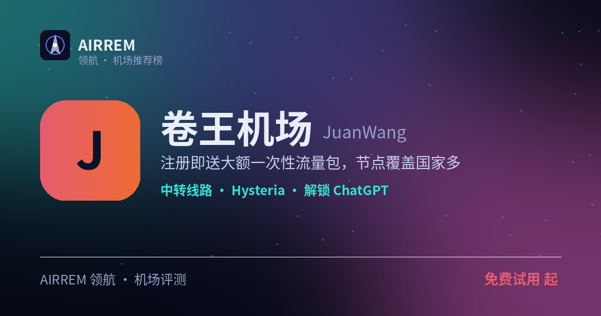

# 卷王机场（YGPY）2026 评测｜多设备不限 · 年付党｜官网入口 · 套餐价格

> **卷王机场** 适合谁？多设备 / 全家共享、想要年付白菜价。全套餐「客户端数量不限」，多设备随便连；年付低至 ¥20/年，把性价比卷到极致

👉 **[卷王机场 官网注册入口](https://i.rtxk.us/i/33zu397)** ｜ [完整评测与横向对比](https://555736.xyz/juanwang/)

---

## 我们的结论

最大亮点是所有套餐「客户端数量不限制」——多设备、全家共享、软路由都不受台数限制，这在同价位机场里相当少见；再加上年付 ¥20 起（每月 100G）的白菜价、订单日自动重置，名副其实的「卷王」。覆盖 11 个地区、入口优化中转；官方禁止滥用分享（发现封号），深度稳定性数据较少，建议先月付或不限时小额验证。

## 基本信息

| 项目 | 内容 |
| --- | --- |
| 机场名称 | 卷王机场（YGPY） |
| 成立时间 |  |
| 线路类型 | 公网隧道中转 |
| 支持协议 | Hysteria / Trojan / VLESS / VMess |
| 流媒体解锁 | ChatGPT / TikTok |
| 节点地区 | 美国 · 香港 · 台湾 · 新加坡 · 日本 · 英国 · 加拿大 · 德国 等 11 地区 |
| 计费方式 | 年付 / 月付 / 不限时买断 |
| 起步价格 | ¥20 / 年 100G |
| 推荐场景 | 多设备 / 全家共享、想要年付白菜价 |

## 卷王机场 套餐价格

| 套餐 | 价格 | 说明 |
| --- | --- | --- |
| 年付-入门版 | ¥20 | 年付 · 每月 100G 自动重置 · 客户端不限 · 365 天 |
| 年付-标准版 | ¥40 | 年付 · 每月 300G 自动重置 · 客户端不限 · 365 天 |
| 年付-高级版 | ¥60 | 年付 · 每月 500G 自动重置 · 客户端不限 · 365 天 |
| 月付-标准版 | ¥20 | 月付 · 每月 1000G 自动重置 · 客户端不限 · 30 天 |
| 月付-高级版 | ¥40 | 月付 · 每月 2500G 自动重置 · 客户端不限 · 30 天 |
| 不限时-入门版 | ¥15 | 一次性买断 · 200G 用完为止 · 客户端不限 |
| 不限时-标准版 | ¥30 | 一次性买断 · 600G 用完为止 · 客户端不限 |
| 不限时-高级版 | ¥60 | 一次性买断 · 1300G 用完为止 · 客户端不限 |

> 价格取自官网购买页：年付/月付订单日自动重置流量，不限时为一次性买断用完为止；全档「客户端数量不限制」，以官网实时价格为准。

## 卷王机场是什么

卷王机场（对外也以 YGPY 出现）主打「把性价比卷到极致」：最突出的是所有套餐都不限制客户端数量，配合年付白菜价与订单日自动重置，适合多设备、全家共享或软路由长期挂着用。

## 线路 · 协议 · 解锁

公开信息显示覆盖美/港/台/新/日/英/加/德/法/荷/俄等 11 个国家地区，数量较多；支持 Hysteria/Trojan/VLESS/VMess，理论兼容 Clash Meta、sing-box、Shadowrocket；流媒体解锁数据较少，ChatGPT/TikTok 更易满足。

- 客户端数量不限制（多设备 / 全家共享无压力）
- 覆盖 11 个国家/地区，入口优化中转
- 协议：Hysteria/Trojan/VLESS/VMess

> 💡 晚高峰稳定性等深度数据较少，建议实测；官方禁止滥用分享，发现封号。

## 优点与缺点

**✅ 优点**

- 全套餐客户端数量不限制，多设备 / 全家共享无压力
- 年付白菜价（¥20/年起），订单日自动重置
- 年付 / 月付 / 不限时买断三种计费，按需灵活
- 覆盖 11 个国家/地区，协议支持主流客户端

**⚠️ 缺点**

- 第三方独立评测与长期数据较少
- 免费套餐是否限速/限期需看官网细则
- 机场行业存在跑路风险，建议先用月付或小额套餐验证稳定性，别一上来就大额年付。

## 适合谁 / 不适合谁

| 👍 适合 | 👎 不适合 |
| --- | --- |
| 家里多设备、想一份订阅全家共享的用户 | 对晚高峰稳定性要求极高、要看详尽第三方测速的谨慎型用户 |
| 预算敏感、想年付长期低价挂机的用户 |  |

## 常见问题

**Q：客户端数量真的不限制吗？**

A：官网套餐页标注所有档位「客户端数量：不限制」，多设备同时在线不受台数限制；但禁止滥用分享，发现会封号。

**Q：怎么买更划算？**

A：长期用选年付（¥20/年起、每月自动重置流量）最划算；想先验证稳定性可买 ¥15 起的不限时小额包，实测晚高峰再加量。

## 同类机场推荐

拿不定主意？可以再看看这几家同类型的：

- **[守候](https://555736.xyz/shouhou/)** — 稳健老用户 / Emby 影音，¥15 起
- **[自由猫](https://555736.xyz/freecat/)** — 日常主力，¥6 起
- **[淘气兔](https://555736.xyz/taoqitu/)** — 联通移动用户，¥7.8 起

全部 38 家机场的横向对比与选购方法论：**[信号塔 SignalTower · 机场大全](https://555736.xyz/airports/)**

---

数据更新：2026-07 ｜ 价格、套餐与优惠码以官网实时为准 ｜ 本仓库为第三方评测整理，与 卷王机场 官方无隶属关系 ｜ 请遵守当地法律法规使用网络服务。

关键词：卷王机场、YGPY、客户端不限机场、多设备共享机场、年付便宜机场、机场推荐
